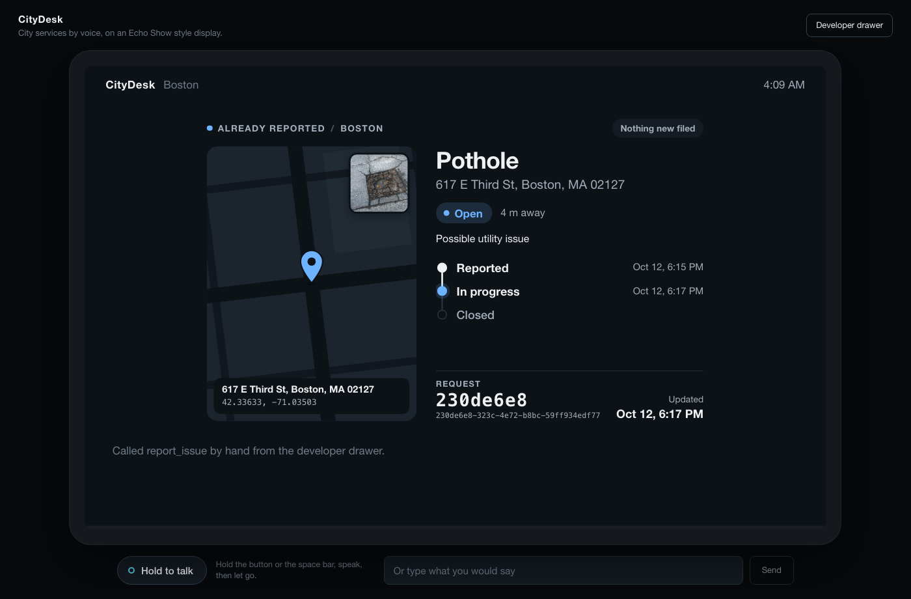
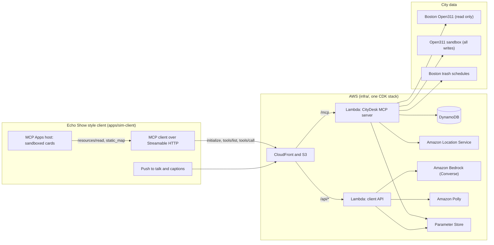

# CityDesk

[](https://github.com/saahilshah178/citydesk/actions/workflows/ci.yml)

**City services by voice.** "There's a huge pothole on Beacon Street by the library." CityDesk
finds the spot, tells you a neighbor already reported it a few steps away, and follows that report for
you instead of filing a duplicate. Days later you ask "what's happening with my requests?" and hear what
changed. It also knows when your trash and recycling go out.

CityDesk is an Alexa+ style integration built as a **self-hosted MCP server** that speaks
[Open311 GeoReport v2](http://wiki.open311.org/GeoReport_v2), the standard many US cities share,
starting with Boston. Because real Alexa+ developer tooling is partner-only, the repo also ships its
own Echo Show style web client, which is a real MCP client (initialize, tools/list, tools/call over
Streamable HTTP) with a Bedrock model playing the assistant.

Built for Amazon's "Build, Ship, Shape" hackathon: Alexa+ track, plus the AWS Builder and Open Source
mini-challenges.



## Status

| | |
| --- | --- |
| MCP server, six tools, cards, web client | Built and tested: 397 automated tests, plus runs against live Boston data |
| Server side of the demo conversation | Passes end to end against live data ([`results/conversation.tools-only.json`](results/conversation.tools-only.json)) |
| Deployable bundles | `cdk synth` succeeds and both Lambda bundles start and serve locally ([`results/bundle_check.json`](results/bundle_check.json)) |
| Bedrock assistant, Polly speech, Amazon Location, DynamoDB, the AWS deployment | **Written and unit-tested, not yet run against AWS.** The build machine had no AWS credentials. `pnpm smoke` reports this on every run |

## What it does

| The resident says | Tool | What happens |
| --- | --- | --- |
| "There's a big pothole in front of 617 East Third Street." | `report_issue` | Finds the place, checks Boston's open requests of the same type within 50 m, and returns the existing report instead of filing |
| "Yes, follow that one." | `follow_request` | Saves the request to the household's list |
| "There's a problem with the streetlight outside 1 City Hall Plaza." | `report_issue` | Asks the one question the service requires ("completely out, flickering, or on during the day?"), then files in a sandbox |
| "Is anything reported near the library?" | `find_nearby_reports` | Lists open requests near a place, nearest first |
| "What's happening with my requests?" | `my_requests` | Loads everything the household filed or follows, in a new session or a new day, and says what changed |
| "What about the streetlight one?" | `request_status` | Current status, the city's latest note, and a timeline |
| "When does the trash go out at 700 Boylston Street?" | `collection_schedule` | Trash and recycling days, the next pickup date, and the next 14 days |

Every tool follows Amazon's Alexa+ tool design guidance: one tool per customer intent; a description
that says when to call it, why, and what it returns; a schema that declares only what is honored;
stable IDs and ISO dates in every result; and structured errors (`isError: true` with a code, a
message and a `retryable` flag), never a bare success flag. Every result starts with a
`spoken_summary` that stands on its own without a screen. The contract is one file:
[`apps/citydesk/src/contract.ts`](apps/citydesk/src/contract.ts).

Two MCP Apps cards (`ui://` resources, `text/html;profile=mcp-app`) are linked from the tools with
`_meta.ui.resourceUri`: an issue card (map pin, status timeline, request ID, photo) and a schedule
card, authored at 768x480 for Echo Show screens.

## Architecture



The browser is the MCP client. The assistant model never sees the MCP server directly: the browser
lists the tools, the backend asks Bedrock which one to call, the browser calls it and renders the
card, and the reply is spoken with Polly.

| Path | What it is |
| --- | --- |
| [`packages/open311-mcp`](packages/open311-mcp) | City-agnostic Open311 client and MCP server, publishable on its own (the Open Source entry) |
| [`apps/citydesk`](apps/citydesk) | The six CityDesk tools, duplicate detection, geocoding, per-household memory, cards, Lambda handler |
| [`apps/sim-client`](apps/sim-client) | The web client: MCP client, MCP Apps host, assistant loop, Bedrock and Polly routes |
| [`infra`](infra) | AWS CDK stack, with `make deploy` and `make destroy` |
| [`scripts`](scripts) | Smoke test, replays and demo runs; everything they measure lands in [`results/`](results) |

## Quickstart

Needs Node.js 22 or newer and pnpm. No AWS account is needed for the first part.

```bash
git clone https://github.com/saahilshah178/citydesk.git
cd citydesk
pnpm install
cp .env.example .env
pnpm build
pnpm sync:addresses     # one 35 MB download from data.boston.gov; makes address lookups instant
pnpm dev                # MCP server :8787, client backend :8788, web client :5173
```

Open <http://localhost:5173/?dev>. The developer drawer shows the live MCP traffic and lets you call
any tool by hand, so you can see the cards with real Boston data straight away. Or run the whole
demo conversation at the tool level, with the assistant taken out:

```bash
pnpm demo:tools         # 7 tool calls against live data, including a new session two minutes later
```

**With AWS credentials** (Bedrock, Polly, and optionally Amazon Location), set `BEDROCK_MODEL_ID` in
`.env` to a model or inference profile your account can invoke, restart `pnpm dev`, and talk to it:
hold the button or the space bar, or type. Then run the scripted conversation through the model:

```bash
pnpm smoke              # checks every external dependency, including one Bedrock call
pnpm demo:conversation  # the full demo conversation: Bedrock decides which tools to call
```

Other useful commands:

```bash
pnpm test               # all four test suites; no network
pnpm demo:places        # today's real places for the demo (an open pothole, a clear streetlight spot)
pnpm replay:dupes       # the duplicate replay over 30 days of Boston requests
npx @modelcontextprotocol/inspector --cli http://localhost:8787/mcp --transport http \
  --header "Authorization: Bearer dev-local-token" --method tools/list
```

### Deploying

```bash
export BEDROCK_MODEL_ID=<a model your account can invoke>
make deploy             # builds, creates the secrets in Parameter Store, bootstraps CDK, deploys
make destroy            # removes the stack and the parameters
```

[`docs/aws.md`](docs/aws.md) lists every service, Region, IAM permission and cost, and what a new
account has to do before the first Bedrock call. `pnpm check:bundles` loads the two Lambda bundles
locally before you upload them.

## How writes stay in sandboxes

CityDesk never files into a city's production system.

- Every create goes through one guard,
  [`packages/open311-mcp/src/guard.ts`](packages/open311-mcp/src/guard.ts). It refuses any endpoint
  that is not declared a test endpoint, refuses a "test" endpoint that points at the production
  server, and runs before a request body is built. Only `ALLOW_PRODUCTION_WRITES=true` (that exact
  string) turns it off.
- A failed POST is never retried after a network error, so a report cannot be filed twice.
- Reads and writes use different systems on purpose: duplicates are checked against Boston's **live**
  requests, and new reports go to a **sandbox**.

Where reports go today: CityDesk's own built-in Open311 sandbox (`createSandbox()` in
`packages/open311-mcp/src/sandbox.ts`), a small GeoReport v2 server with service definitions,
required attributes and a simulated lifecycle whose notes all say "simulated". You can read what was
filed at `/sandbox/open311/v2/requests.json` on the server. The two sandboxes we set out to use were
not usable: the test endpoint in Boston's discovery file does not resolve, and SeeClickFix's test
server would not accept a new request without an account token (friction log entries 1 and 5). Both
are still configured, and Boston's is tried first on every filing in case it comes back.

## AWS services

| Service | Used for | Called from |
| --- | --- | --- |
| Amazon Bedrock | The assistant model, through the Converse API with tool use | [`apps/sim-client/server/bedrock.ts`](apps/sim-client/server/bedrock.ts) |
| AWS Lambda | The MCP server and the client backend, behind Function URLs | [`apps/citydesk/src/lambda.ts`](apps/citydesk/src/lambda.ts), [`apps/sim-client/server/lambda.ts`](apps/sim-client/server/lambda.ts) |
| Amazon DynamoDB | Each household's filed and followed requests, saved address, sandbox requests, and the cost ceilings | [`apps/citydesk/src/store/dynamo.ts`](apps/citydesk/src/store/dynamo.ts), [`apps/sim-client/server/aws.ts`](apps/sim-client/server/aws.ts) |
| Amazon Location Service | Geocoding spoken addresses and landmarks inside the city's bounding box; map images for the issue card | [`apps/citydesk/src/geocode/amazonLocation.ts`](apps/citydesk/src/geocode/amazonLocation.ts), [`apps/citydesk/src/aws/staticMap.ts`](apps/citydesk/src/aws/staticMap.ts) |
| Amazon Polly | Speaking the replies | [`apps/sim-client/server/app.ts`](apps/sim-client/server/app.ts) |
| S3 and CloudFront | The web client, and one origin for `/api/*` and `/mcp` | [`infra/lib/citydesk-stack.ts`](infra/lib/citydesk-stack.ts) |
| Systems Manager Parameter Store | The bearer token, API keys and allowed origins | [`apps/citydesk/src/aws/parameters.ts`](apps/citydesk/src/aws/parameters.ts) |

Keys live only in environment variables or Parameter Store. The public endpoints have daily
ceilings counted in DynamoDB (assistant and speech requests, geocodes, map images, new reports), so
a stranger with the demo token cannot run up a bill. Details and costs: [`docs/aws.md`](docs/aws.md).

## Results

Every number here comes from a run whose output is saved under [`results/`](results).

**How often would a new report have been a duplicate?**
([`results/dupes.json`](results/dupes.json), `pnpm replay:dupes`.) We replayed 23,017 real Boston
requests filed between 2026-09-13 and 2026-10-12 in the order they were filed, and asked of each one
what `report_issue` asks: was a request of the same type already open within 50 m?

| Requests | Replayed | Had an open one within 50 m | Share |
| --- | ---: | ---: | ---: |
| Fixed infrastructure (potholes, streetlights, sidewalks, signals, signs, graffiti, fallen trees) | 3,617 | 965 | 26.7% |
| Potholes | 495 | 117 | 23.6% |
| Streetlight outages | 504 | 153 | 30.4% |
| Everything except Illegal Parking | 16,124 | 2,667 | 16.5% |
| All requests | 23,017 | 8,226 | 35.7% |

Read these as upper bounds on duplicates: a match means an open request of the same type existed
nearby, not that a person confirmed it was the same problem. The overall figure is inflated by
Illegal Parking, where Boston leaves 89% of requests marked open, so 80.6% of new ones match. The
share moves with the radius: 28.5% at 25 m, 35.7% at 50 m, 44.2% at 100 m.

**The demo conversation, server side.**
([`results/conversation.tools-only.json`](results/conversation.tools-only.json), `pnpm demo:tools`.)
Seven tool calls over a real MCP connection against live Boston data, with a second session 130
seconds later: the pothole report returned Boston's existing request, the streetlight report asked
its one question and was filed in the sandbox, the second session remembered both requests and
reported that the sandbox one had been assigned, and the trash schedule came back. All seven outcomes
were as expected. Tool calls answered from the local index, the sandbox or a warm cache took 3 to 5
ms; calls that reach Boston took 279 and 442 ms; a duplicate check with a cold cache, which downloads
Boston's open list afresh, took 1,267 ms.

**Other runs**

| What | Result | Saved in |
| --- | --- | --- |
| Automated tests (no network) | 397 of 397 pass in 29 files | [`results/tests.json`](results/tests.json) |
| MCP Inspector, manual pass | Both servers: tools/list and 9 tool calls, including a structured error | [`results/inspector/`](results/inspector) |
| Cards in the ext-apps `basic-host` | Both cards, 17 states, at 768x480 and 1280x800 | [`results/cards/`](results/cards) |
| Cards in our client, live data | Issue card and schedule card | [`results/integration/`](results/integration) |
| Boston address index | 139,050 buildings from 399,489 address rows; lookups under 1 ms | [`results/address_index.json`](results/address_index.json) |
| Lambda bundles loaded locally | 12 of 12 checks; MCP bundle 3.5 MB, cold load under 0.3 s | [`results/bundle_check.json`](results/bundle_check.json) |
| Smoke test | 6 pass, 1 degraded (Boston's test endpoint), 1 fail (Bedrock: no credentials on this machine) | [`results/smoke.json`](results/smoke.json) |

## Limitations

- **Not connected to Alexa+.** The client is our own; the MCP server is what an Alexa+ add-on would
  call. Identity is a demo bearer token plus a per-browser device ID, not OAuth account linking.
- **AWS paths are not yet verified live** (see Status). Until they are, there is no recorded run of
  the Bedrock assistant, Polly, Amazon Location or DynamoDB.
- **Reports are filed in CityDesk's own sandbox**, not a city's. Boston also lists only 6 request
  types as fileable through its API, so filing real potholes there is not possible today regardless.
- **Duplicate detection is type, distance and recency.** It does not read descriptions or photos. It
  will sometimes offer a nearby report that is a different problem, which is why the assistant asks
  before following.
- **Without Amazon Location, only street addresses are understood** (from Boston's address records).
  Landmarks and intersections need the place index.
- **Speed.** Alexa+ guidance is a round trip under 500 ms. Calls that reach Boston's API take about
  0.3 s warm and longer cold; the server caches Boston's open list for two minutes to stay close.
- **Boston's API allows about 10 requests a minute without a key**, and its public hostname answers
  heavier use with a challenge page. The server uses the endpoint the discovery file lists, limits
  itself, and fails fast with a retryable error instead of queueing.
- **Trash days do not account for holiday weeks**, when Boston collects a day late.
- **Speech input** uses the browser's Web Speech API, which is not available everywhere; typing
  always works.
- **Cards show times in the device's time zone**, because the contract carries no zone per request.

## More

- [`FRICTION_LOG.md`](FRICTION_LOG.md): 25 entries, each with task, steps, expected vs actual,
  severity, workaround and suggestion.
- [`FEEDBACK.md`](FEEDBACK.md): product feedback on every tool used.
- [`docs/aws.md`](docs/aws.md): AWS services, IAM, Regions, model access, costs.
- [`docs/submission.md`](docs/submission.md): Devpost text, Open Source fields, video script.
- [`packages/open311-mcp/README.md`](packages/open311-mcp/README.md): the standalone package.

## License

MIT. See [LICENSE](LICENSE).
